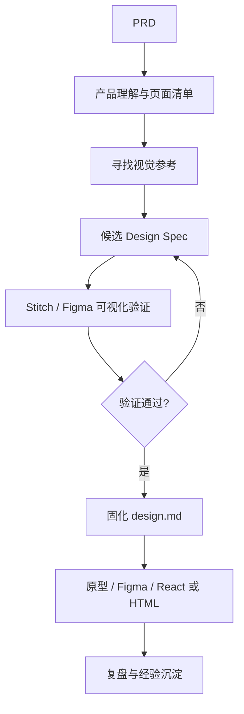

# Visual Design Pipeline

**从 PRD 到产品原型、Figma 设计稿与前端页面的 AI 设计工作流。**

[English](README.en.md) · [我的中文工作流](docs/工作流.md) · [安装与使用](docs/安装与使用.md) · [Codex Skill](SKILL.md)

> 参考定方向，规范控质量，验证减少偏差，复盘积累经验。

## 设计理念

很多人期待 AI 从 PRD 一步生成高质量页面，却常常遇到风格不稳定、组件不一致、反复返工等问题。这个项目把设计过程拆成可验证的阶段，让产品经理、FDE、开发者**只提供 PRD 也可以启动**。

## 流程



**Design Spec ≠ design.md**：前者是待验证的规则，后者是根据经过确认的页面固化的正式规范。

## 快速开始

```bash
git clone https://github.com/guisiyu99/visual-design-pipeline.git ~/.agents/skills/visual-design-pipeline
```

打开 Codex，在有 PRD 的工作区发送：

> 使用 $visual-design-pipeline。这是我的 PRD：[附件或路径]。我只有需求，没有视觉参考。请先分析产品与页面清单，主动提供视觉方向，再验证 Design Spec。验证通过后生成 design.md，不要立即开发整站。

## 适用情境

| 输入 | 工作流入口 |
| --- | --- |
| 只有 PRD | 产品理解 → 参考选择 → 验证 |
| PRD + 参考图 | 提炼候选规范 → 验证 |
| 已有确认 design.md | 检查适用性 → 页面生产 |
| 已有界面要修改 | 诊断问题 → 局部回退 |

## 仓库内容

- [SKILL.md](SKILL.md) — 执行规则、阶段门禁和引导方式
- [docs/工作流.md](docs/工作流.md) — 适合分享的简明方法
- [docs/安装与使用.md](docs/安装与使用.md) — 安装与启动说明
- [README.en.md](README.en.md) — English introduction
- [CHANGELOG.md](CHANGELOG.md) — 版本说明

**状态：V3 Beta。** 这套方法仍需要在更多真实产品中检验；生成的设计或代码不等于完成产品验收。Figma/Stitch 的访问取决于实际工具连接与权限。

欢迎通过 GitHub Issues 提供场景、失败案例、复盘和改进建议。
